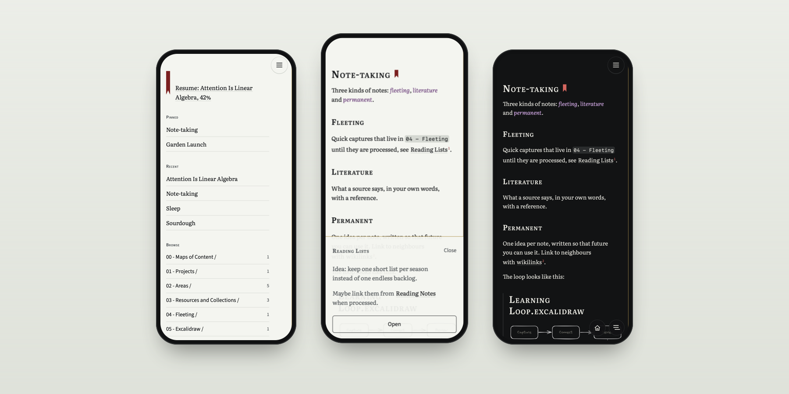
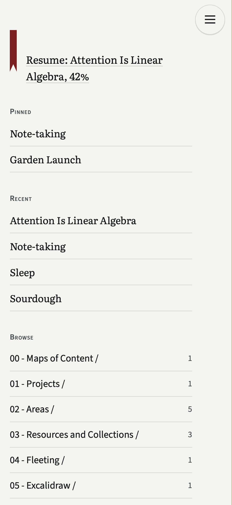
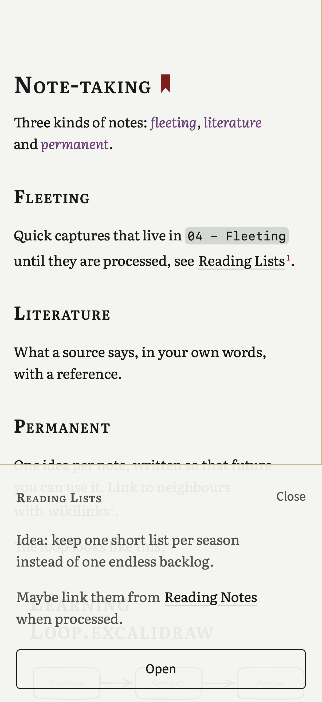
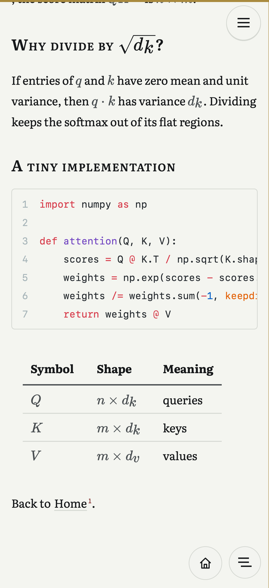
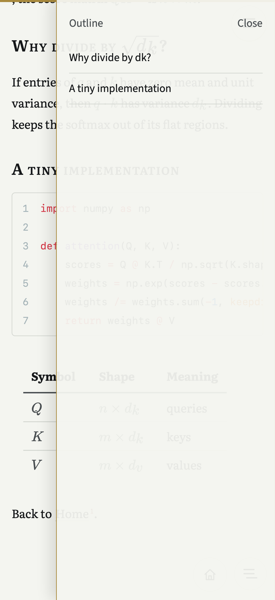
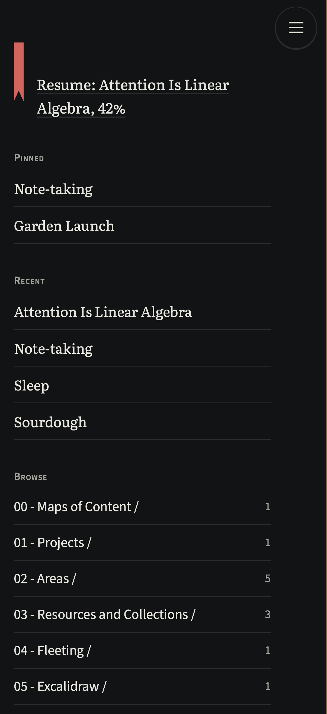
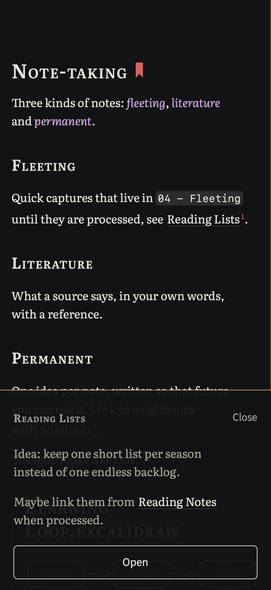
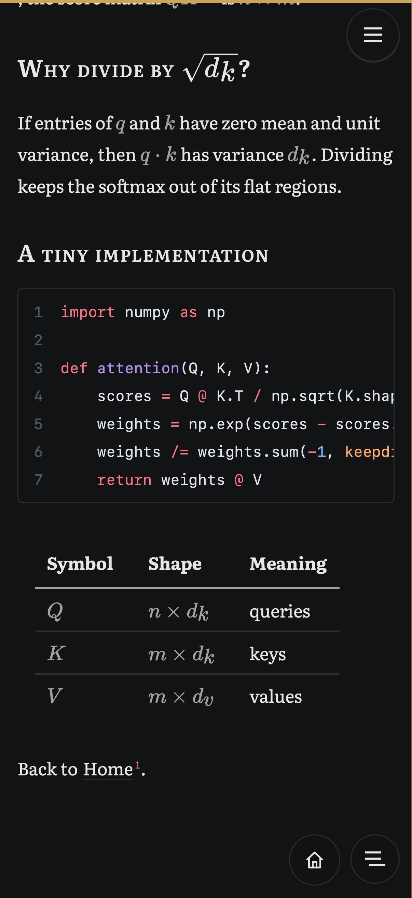
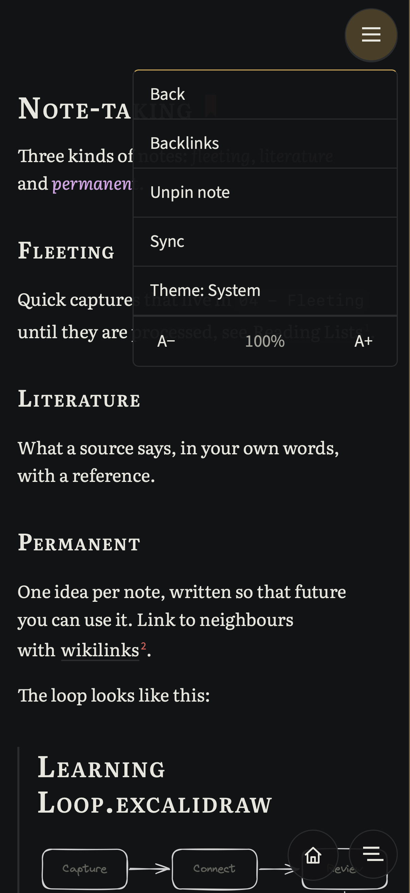
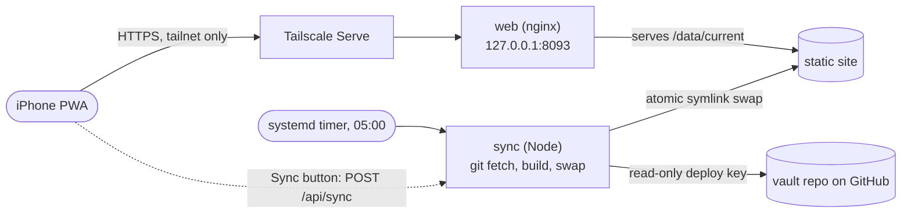

<div align="center">



# Digital Garden

**A calm, phone-first reading room for your Obsidian vault.**<br>
Read-only. Self-hosted. Installs as an iPhone app. Built on [Quartz](https://quartz.jzhao.xyz).

[](https://github.com/Sarcovora/Digital-Garden/actions/workflows/ci.yml)
[](LICENSE)


</div>

---

Your notes live in Obsidian on a laptop. This is for the other 90% of the day: finding a note in seconds on your phone, reading a long one without fighting the interface, and following links without losing your place.

It is deliberately **not** a docs site, not an Obsidian clone, and not a publishing tool. It is a private reading room for one person's own notes, designed like a page from a thin-paper reference Bible: text first, with cross-references living in the margin.

## Highlights

- **Reads like a book.** Cool paper, near-black ink, a screen serif ([Literata](https://fonts.google.com/specimen/Literata)) at reading size, small-caps headings. A designed dark theme, not an inverted one. Text size from 25% to 200%.
- **Links are verse numerals.** Every wikilink gets a small superscript number. Tap it and an onionskin sheet rises over the page showing the linked passage, without leaving where you are. Long-press a link for the same.
- **Obsidian fidelity.** Wikilinks, page and block embeds, callouts, LaTeX, mermaid, tasks, `==highlights==`, footnotes, and single line breaks that stay line breaks, as in Obsidian. Highlight, bold and italic each get their own colour so things are easy to find.
- **Excalidraw drawings, pre-rendered.** Drawings become cached SVGs at build time, so they are ready before you open the note. They invert cleanly in dark mode.
- **Pull down to search.** Pull down hard from the top of any page, like pull-to-refresh, and search slides in. The home screen has no floating bar to get in the way: a ribbon resumes where you stopped, then pinned notes, recent notes, and a file explorer that drills into your folders in place.
- **Full-screen, one-handed.** Installed from Safari it fills the whole screen, under the clock, like a native app. While reading there is almost nothing on it: a thin progress bar across the top, a menu button at the top right, and **Home** and **Outline** within thumb reach at the bottom right. The outline slides in from the right and jumps to any heading. Swipe from the left edge to go back through the notes you visited.
- **Feels physical.** Taps, text-size steps, pins and a finished sync give small haptic ticks on iPhone (iOS 18+) and Android; set `localStorage["garden:haptics"] = "off"` to silence them. Every control shows its pressed state the instant a finger lands.
- **Works offline.** A service worker caches the shell and the notes you open, stamped per build.
- **Syncs itself.** A tiny sync service pulls your vault's git repository daily and on demand from a button in the app, rebuilds, and swaps the new site in atomically. The button greys out when there is nothing new.
- **Private by construction.** Read-only deploy key, loopback-bound web container, meant to sit behind [Tailscale Serve](https://tailscale.com/kb/1242/tailscale-serve) or another private proxy. Nothing is exposed publicly.

<table>
  <tr>
    <td align="center"><br><sub>Home</sub></td>
    <td align="center"><br><sub>Reference sheet</sub></td>
    <td align="center"><br><sub>Math and code, with the progress bar</sub></td>
    <td align="center"><br><sub>Outline</sub></td>
  </tr>
  <tr>
    <td align="center"><br><sub>Home, night</sub></td>
    <td align="center"><br><sub>Reference sheet, night</sub></td>
    <td align="center"><br><sub>Math and code, night</sub></td>
    <td align="center"><br><sub>Menu, night</sub></td>
  </tr>
</table>

<sub>All screenshots are of the sample vault in [`examples/demo-vault`](examples/demo-vault), captured at iPhone 16 Pro size (402 x 874) in WebKit by `npm run screenshots`.</sub>

## Try it in two minutes

You need Node 22 or newer.

```bash
git clone https://github.com/Sarcovora/Digital-Garden.git
cd Digital-Garden
npm ci
npx quartz build -d examples/demo-vault --serve
```

Open <http://localhost:8080>. Use your browser's device toolbar (or your phone on the same network) for the phone layout. The demo vault is original sample content that shows every feature: embeds, math, mermaid, an Excalidraw drawing, callouts, tasks and a block-embedded verse.

To read your own vault instead, point `-d` at it: `npx quartz build -d /path/to/vault --serve`.

## Run it for real

The production setup is two containers behind a private proxy:



1. **Prepare the vault checkout** on the server: `git clone` your vault repository somewhere.
2. **Add a read-only deploy key** to that repository (GitHub: Settings, Deploy keys, leave "Allow write access" unticked). Keep the private key on the server.
3. **Configure.** `cp .env.example .env` and set `VAULT_PATH`, `DATA_PATH`, `DEPLOY_KEY_PATH`, and `GARDEN_UID` / `GARDEN_GID` (`id -u`, `id -g`).
4. **Start it.** `docker compose up -d --build`. The first sync builds the site.
5. **Put a private proxy in front.** For example `tailscale serve --bg --https=8444 http://127.0.0.1:8093`. Keep the `127.0.0.1:` bind in `HTTP_PORT`: Docker publishes ports around `ufw`, so the bind address is what actually keeps it private.
6. **Optional: a daily sync.** `bash deploy/install-systemd.sh` installs a timer that triggers the same sync as the button, at 05:00.
7. **Install on your phone.** Open the URL in Safari, Share, Add to Home Screen. A checklist for verifying the installed app is in [`docs/device-checklist.md`](docs/device-checklist.md).

A full build of about 3,000 notes takes roughly 35 seconds on a modern server, and the previous two builds are kept so a bad build can never take the site down.

### The sync API

The sync container is not published to the host. The web container's nginx proxies two endpoints to it:

| Endpoint | What it does |
| --- | --- |
| `GET /api/status` | `{ state, behind, lastSyncedAt, commit, buildId, error, checkError }` |
| `POST /api/sync` | Fetch, fast-forward, rebuild if there is something new. Requires the header `X-Garden: 1`. Returns 202 when a build started, 200 when already up to date, 409 when one is running, 502 when GitHub cannot be reached. |
| `POST /api/sync?force=1` | Rebuild even if nothing changed (after a theme or code change). |

### Configuration

| Variable | Default | Meaning |
| --- | --- | --- |
| `HTTP_PORT` | `127.0.0.1:8093` | Where the web container listens. Keep the loopback prefix. |
| `VAULT_PATH` | | Host path of the vault's git checkout. |
| `DATA_PATH` | `./data` | Builds, status and `known_hosts`. |
| `DEPLOY_KEY_PATH` | | Read-only deploy key (private key file). |
| `GARDEN_UID`, `GARDEN_GID` | `1001` | The sync container runs as this user so it can write the checkout and data. |
| `BUILD_THREADS` | `12` | Quartz parse threads. |

## How it is built

[Quartz 4](https://quartz.jzhao.xyz) does the heavy lifting (markdown, wikilinks, embeds, callouts, math, backlinks). This repository replaces its look and navigation entirely and adds the pieces a phone reader needs.

| Piece | Where |
| --- | --- |
| Theme tokens, paper, ink, oxblood, gilt | [`quartz/styles/_garden-tokens.scss`](quartz/styles/_garden-tokens.scss), [`DESIGN.md`](DESIGN.md) |
| Home screen, explorer, resume ribbon | [`quartz/components/GardenHome.tsx`](quartz/components/GardenHome.tsx) |
| Reading chrome: menu, outline, sheet, swipe-back | [`quartz/components/GardenChrome.tsx`](quartz/components/GardenChrome.tsx) and `scripts/` beside it |
| Excalidraw to SVG at build time, cached by content hash | [`quartz/plugins/transformers/excalidraw.ts`](quartz/plugins/transformers/excalidraw.ts), [`scripts/excalidraw/`](scripts/excalidraw) |
| Obsidian parity: line breaks, spaced link targets | [`quartz/plugins/transformers/spacedLinks.ts`](quartz/plugins/transformers/spacedLinks.ts), `quartz.config.ts` |
| Embed-cycle guard (A embeds B embeds A) | [`quartz/components/renderPage.tsx`](quartz/components/renderPage.tsx) |
| Service worker, build-stamped | [`quartz/plugins/emitters/gardenServiceWorker.ts`](quartz/plugins/emitters/gardenServiceWorker.ts) |
| Sync service: fetch, build, verify, atomic swap | [`sync/`](sync) |
| Build verifier (no stray `[[`, no missing pages) | [`scripts/verify-build.mjs`](scripts/verify-build.mjs) |
| Docker and systemd | [`docker/`](docker), [`docker-compose.yml`](docker-compose.yml), [`deploy/`](deploy) |

Device-local state (theme, text size, pins, recents, where you stopped) lives in `localStorage` on the phone, so the server stays a dumb static site with no accounts and no database.

## Development

```bash
npm ci
npx tsc --noEmit        # types
npm test                # 150+ unit tests (state, sync service, build helpers)
npm run test:build      # Quartz builds of a fixture vault, checked for fidelity
npm run test:e2e        # iPhone WebKit tests against a built fixture site
npm run screenshots     # rebuild docs/images from examples/demo-vault
```

The tests run against a small synthetic vault in [`tests/fixture-vault`](tests/fixture-vault); no real notes are ever used in tests or screenshots. CI runs everything on every push.

## Good to know

- **iPhone-first.** Desktop works but is not designed for; on a desktop, open the vault in Obsidian.
- **Read-only, always.** There is no editing and no write path to your vault.
- **One reader.** There are no accounts. Pins and recents live on each device.
- **Sync needs a git remote.** The vault is expected to be a git repository the server can pull from.
- **Status bar.** To draw under the clock, the app uses iOS's translucent status bar, which always shows a white clock, so the strip under it is solid ink in the light theme. If you would rather have a standard bar, change `apple-mobile-web-app-status-bar-style` back to `default` in `quartz/components/Head.tsx`.
- **Inline footnotes** (`^[like this]`) are not rendered; standard `[^1]` footnotes are.

## Credits

Built on [Quartz](https://github.com/jackyzha0/quartz) by Jacky Zhao and contributors (MIT). Typefaces: [Literata](https://github.com/googlefonts/literata) and [Source Sans 3](https://github.com/adobe-fonts/source-sans) (SIL OFL). Math by [KaTeX](https://katex.org), diagrams by [Mermaid](https://mermaid.js.org), drawings by [Excalidraw](https://excalidraw.com).

## License

[MIT](LICENSE). Quartz's original copyright notice is retained.
